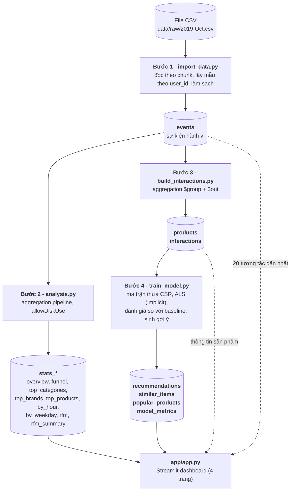

# Kiến trúc hệ thống

Tài liệu mô tả luồng dữ liệu, các collection trong MongoDB, lý do chọn MongoDB
và các quyết định thiết kế chính của đồ án **Phân tích dữ liệu thương mại điện
tử và hệ thống gợi ý sản phẩm**.

## 1. Luồng dữ liệu



Toàn bộ pipeline được điều phối bởi `src/run_pipeline.py` theo đúng thứ tự
trên. Mỗi bước chỉ đọc dữ liệu từ MongoDB và ghi kết quả lại MongoDB, nên có
thể chạy riêng từng bước hoặc chạy lại một bước mà không phải làm lại các bước
trước (`--skip-import`).

### Phân vai giữa MongoDB và Python

| Việc | Thực hiện ở | Lý do |
|---|---|---|
| Đếm, gom nhóm, xếp hạng, tính phễu, phân bố giờ/thứ | MongoDB (aggregation) | Dữ liệu lớn nằm sẵn trong DB; chỉ kết quả nhỏ được trả về |
| Tạo `products`, `interactions` | MongoDB (`$group` + `$out`) | Gộp hàng chục triệu sự kiện mà không kéo về Python |
| Chấm điểm phân vị RFM (`pd.qcut`) | pandas | Chỉ làm trên bảng nhỏ (một dòng mỗi khách có mua) |
| Huấn luyện ALS, đánh giá, sinh gợi ý | Python (`implicit`) | Cần phân rã ma trận thưa, MongoDB không làm được |
| Hiển thị | Streamlit | Đọc trực tiếp các collection kết quả đã tính sẵn |

## 2. Các collection

Các ví dụ dưới đây là tài liệu thật sinh ra khi chạy pipeline trên dữ liệu mẫu
(`scripts/generate_sample.py`).

### Nhóm dữ liệu gốc

#### `events` - sự kiện hành vi

Mỗi tài liệu là một dòng của file CSV sau khi làm sạch. Cột `category_id` bị
bỏ; `category_code` và `brand` có thể là `null`.

```json
{
  "event_time": "2019-10-01T00:02:10Z",
  "event_type": "view",
  "product_id": 80671671,
  "category_code": "sport.bicycle",
  "brand": "razer",
  "price": 71.2,
  "user_id": 345644325,
  "user_session": "d3d7c523-3915-404d-8be1-5608f76e7eb4"
}
```

- `event_type` thuộc `view`, `cart`, `purchase`; `event_time` là kiểu `Date`
  (giờ UTC).
- Index: `user_id`, `product_id`, `event_type`, `event_time`.

### Nhóm trung gian cho mô hình

#### `products` - thông tin sản phẩm

Tạo bằng `$group` theo `product_id`. `category_code` và `brand` lấy bằng
`$max` vì `$max` bỏ qua `null`: nếu có ít nhất một sự kiện ghi đủ thông tin thì
sản phẩm có thông tin đó.

```json
{
  "product_id": 67554178,
  "category_code": "apparel.tshirt",
  "brand": "vitek",
  "avg_price": 19.79,
  "views": 259,
  "carts": 14,
  "purchases": 12
}
```

- Index: `product_id` (unique).

#### `interactions` - tương tác user x sản phẩm

Mỗi tài liệu là một cặp `(user_id, product_id)`. Điểm `score` là tổng điểm của
mọi sự kiện giữa hai bên: **view = 1, cart = 3, purchase = 5**. Đây là phản
hồi ngầm (implicit feedback) dùng làm đầu vào cho ALS.

```json
{
  "user_id": 522383716,
  "product_id": 73737517,
  "score": 1,
  "views": 1,
  "carts": 0,
  "purchases": 0,
  "last_time": "2019-10-22T16:02:29Z"
}
```

- Index: `user_id`, `product_id`.

### Nhóm kết quả phân tích (`stats_*`)

Mỗi collection được ghi đè hoàn toàn mỗi lần chạy `analysis.py`.

| Collection | Số tài liệu | Nội dung |
|---|---|---|
| `stats_overview` | 1 | Tổng sự kiện, người dùng, sản phẩm, phiên, doanh thu |
| `stats_funnel` | 1 | Số view/cart/purchase và các tỷ lệ chuyển đổi |
| `stats_top_categories` | 40 | Top 20 danh mục theo doanh thu + top 20 theo lượt mua |
| `stats_top_brands` | 40 | Tương tự, theo thương hiệu |
| `stats_top_products` | 40 | Tương tự, theo sản phẩm |
| `stats_by_hour` | 24 | Sự kiện và doanh thu theo giờ trong ngày (UTC) |
| `stats_by_weekday` | 7 | Sự kiện và doanh thu theo thứ trong tuần |
| `stats_rfm` | 1 dòng / khách có mua | Điểm R, F, M và nhóm khách hàng |
| `stats_rfm_summary` | 5 | Tổng hợp theo nhóm khách hàng |

```jsonc
// stats_overview
{
  "_id": "overview",
  "total_events": 200000,
  "total_users": 5000,
  "total_products": 2000,
  "total_sessions": 44539,
  "total_revenue": 1583155.1,
  "first_event": "2019-10-01T00:02:10Z",
  "last_event": "2019-10-31T23:59:59Z",
  "computed_at": "2026-11-25T03:25:40Z"
}
```

```jsonc
// stats_funnel
{
  "_id": "funnel",
  "views": 177825, "carts": 13240, "purchases": 8935,
  "view_to_cart": 0.0745,
  "cart_to_purchase": 0.6748,
  "view_to_purchase": 0.0502
}
```

```jsonc
// stats_top_categories (tương tự stats_top_brands, stats_top_products)
{
  "metric": "revenue",          // hoặc "purchases"
  "rank": 1,
  "category_code": "computers.notebook",
  "revenue": 157063.59,
  "purchases": 186
}
```

```jsonc
// stats_by_hour (stats_by_weekday có thêm weekday 1..7 và label "Thứ Hai")
{ "hour": 0, "events": 2545, "views": 2266, "carts": 159,
  "purchases": 120, "revenue": 20514.87 }
```

```jsonc
// stats_rfm
{
  "user_id": 100009619,
  "recency_days": 5.11,
  "frequency": 2,
  "monetary": 569.79,
  "r_score": 4, "f_score": 4, "m_score": 4,
  "rfm_score": "444",
  "segment": "Khách VIP"
}
```

```jsonc
// stats_rfm_summary
{
  "segment": "Khách VIP",
  "users": 646, "pct_users": 18.87,
  "revenue": 751261.95, "pct_revenue": 47.45,
  "avg_recency_days": 4.0, "avg_frequency": 4.93, "avg_monetary": 1162.94
}
```

Cách tính RFM:

- **Recency**: số ngày từ lần mua gần nhất đến ngày sau sự kiện cuối cùng của
  dữ liệu.
- **Frequency**: số phiên (`user_session`) có phát sinh mua hàng - gom hai tầng
  `(user, phiên)` rồi `user` ngay trong aggregation.
- **Monetary**: tổng giá trị các đơn mua.
- Điểm 1-5 chấm bằng phân vị (`pd.qcut`) trên thứ hạng. Frequency trùng nhau
  rất nhiều (đa số khách chỉ mua một phiên) nên các khách cùng Frequency được
  phân biệt tiếp bằng Monetary để luôn chia được đủ 5 nhóm.
- Nhóm khách hàng xét lần lượt: **VIP** (R, F, M >= 4) -> **trung thành**
  (R >= 3 và F >= 4) -> **tiềm năng** (R >= 4) -> **cần chăm sóc** (R = 3,
  hoặc R <= 2 nhưng F >= 4) -> **sắp rời bỏ** (còn lại).

### Nhóm kết quả mô hình

#### `recommendations` - top-10 gợi ý cho mỗi người dùng

```json
{
  "user_id": 100009619,
  "recommendations": [
    { "product_id": 47960868, "score": 0.8305,
      "category_code": "electronics.smartphone", "brand": "lg", "price": 92.05 },
    { "product_id": 81026625, "score": 0.7815,
      "category_code": "electronics.smartphone", "brand": "adidas", "price": 706.78 }
  ]
}
```

- Các sản phẩm người dùng đã tương tác bị loại khỏi danh sách.
- Chỉ người dùng có từ `MIN_USER_INTERACTIONS` (mặc định 2) sản phẩm trở lên
  mới được huấn luyện nên mới có tài liệu ở đây; còn lại là cold-start.
- Index: `user_id` (unique).

#### `similar_items` - top-10 sản phẩm tương tự

Chỉ tính cho sản phẩm có từ 5 tương tác trở lên (ít hơn thì vector nhân tố
không đáng tin). Điểm là độ tương tự cosine giữa các vector nhân tố ẩn.

```json
{
  "product_id": 1151961,
  "similar": [
    { "product_id": 45704637, "score": 0.8425,
      "category_code": "kids.fmcg.diapers", "brand": "razer", "price": 23.55 }
  ]
}
```

- Index: `product_id` (unique).

#### `popular_products` - top-50 sản phẩm phổ biến (cold-start)

Xếp theo tổng điểm tương tác trên toàn bộ `interactions`. Dùng cho người dùng
mới hoặc chưa đủ lịch sử.

```json
{
  "rank": 1, "product_id": 20111107, "score": 690, "purchases": 27,
  "category_code": "sport.tennis", "brand": "lego", "price": 25.91
}
```

- Index: `rank` (unique).

#### `model_metrics` - kết quả đánh giá mỗi lần huấn luyện

Mỗi lần chạy `train_model.py` thêm một tài liệu (giữ lịch sử để so sánh các
bộ tham số). Dashboard hiển thị lần gần nhất.

```json
{
  "created_at": "2026-11-25T03:25:45Z",
  "k": 10,
  "model": "implicit.als.AlternatingLeastSquares",
  "params": { "factors": 64, "regularization": 0.05, "alpha": 1.0,
              "iterations": 20, "random_state": 42,
              "train_percentage": 0.8, "min_user_interactions": 2 },
  "dataset": { "n_users_before_filter": 5000, "n_users": 4984,
               "n_items": 2000, "n_interactions": 137930,
               "density": 0.0138, "n_train": 110459, "n_test": 27471 },
  "results": {
    "als":        { "precision": 0.267349, "map": 0.121518,
                    "ndcg": 0.21334,  "auc": 0.611433 },
    "popularity": { "precision": 0.019999, "map": 0.005786,
                    "ndcg": 0.014709, "auc": 0.506486 }
  },
  "train_seconds": { "evaluation_fit": 0.89, "final_fit": 0.9 },
  "eval_seconds": 0.58
}
```

## 3. Quyết định thiết kế

### Lấy mẫu theo người dùng

`SAMPLE_PERCENT` giữ các dòng có `user_id % 100 < SAMPLE_PERCENT`. Lấy mẫu
theo **người dùng** (không phải theo dòng) để mỗi người dùng được giữ trọn vẹn
lịch sử: nếu lấy ngẫu nhiên theo dòng, ma trận user x sản phẩm bị thưa đi một
cách giả tạo và mô hình gợi ý kém đi. Cách này không cần đọc trước cả file,
tất định và áp dụng được trong lúc đọc từng chunk.

### Điểm tương tác

View = 1, cart = 3, purchase = 5 phản ánh mức độ quan tâm tăng dần. Điểm của
một cặp (user, sản phẩm) là **tổng** nên xem nhiều lần hoặc xem rồi mua đều
làm điểm tăng. Điểm càng cao, thư viện implicit coi độ tin cậy của quan sát
càng lớn (tham số `alpha` nhân vào giá trị này).

### Đánh giá công bằng

- Chia ngẫu nhiên 80/20 **các tương tác** bằng
  `implicit.evaluation.train_test_split` (cố định `random_state`).
- ALS và baseline "sản phẩm phổ biến nhất" cùng được đo bằng
  `ranking_metrics_at_k` trên đúng một tập train/test; baseline được cài đặt
  với cùng giao diện `recommend` nên không có sự khác biệt về cách tính.
- Độ phổ biến của baseline chỉ tính từ tập train (không nhìn thấy tập test).
- `precision` của implicit chia cho `min(K, số sản phẩm test của người dùng)`
  chứ không phải cho K, nên **cao hơn** precision@K = số trúng / K thông
  thường. Đây là cách tính của thư viện và áp dụng giống nhau cho cả hai mô
  hình.
- Sau khi đánh giá, mô hình được huấn luyện lại trên toàn bộ dữ liệu trước khi
  sinh gợi ý.

### Cold-start

- Người dùng không có trong hệ thống hoặc có ít hơn `MIN_USER_INTERACTIONS`
  sản phẩm: dashboard hiển thị `popular_products` kèm ghi chú.
- Sản phẩm có dưới 5 tương tác: không có danh sách `similar_items`.

## 4. Vì sao chọn MongoDB

**Schema linh hoạt.** Dữ liệu hành vi có nhiều trường thiếu (`category_code`,
`brand` có thể `null` hoặc vắng mặt) và mỗi collection kết quả có hình dạng
khác nhau: `recommendations` chứa mảng lồng nhau, `model_metrics` chứa tham số
và độ đo lồng nhau. Lưu trực tiếp dưới dạng tài liệu JSON/BSON, không cần
thiết kế bảng quan hệ hay phép nối: một lần đọc `recommendations` cho ra
ngay cả danh sách sản phẩm kèm thông tin hiển thị (đã phi chuẩn hoá để dashboard
đọc nhanh).

**Aggregation pipeline.** Phần lớn phân tích là gom nhóm và xếp hạng trên
hàng chục triệu sự kiện: `$match`, `$group`, `$sort`, `$limit`, `$project`,
`$lookup`, `$setWindowFields`, `$out`. Chạy ngay trong DB, chỉ trả về kết quả
nhỏ; `allowDiskUse=True` cho phép gom nhóm vượt quá 100MB bộ nhớ mỗi stage
bằng cách ghi tạm ra đĩa. Pipeline là dữ liệu (danh sách dict) nên dễ sinh theo
tham số và dễ kiểm thử.

**Index.** Bốn index trên `events` (`user_id`, `product_id`, `event_type`,
`event_time`) phục vụ: lấy lịch sử của một người dùng cho dashboard, lọc
`event_type = purchase` khi tính RFM và xếp hạng (trên dữ liệu thật chỉ
khoảng 2% sự kiện là mua nên truy vấn rất rẻ). Các collection kết quả có index duy nhất trên khoá
tra cứu (`user_id`, `product_id`, `rank`) nên dashboard đọc gợi ý theo khoá
trong thời gian gần như hằng số.

**Mở rộng ngang bằng sharding.** Khi dữ liệu vượt dung lượng một máy, MongoDB
có thể chia `events` ra nhiều shard. Đồ án chạy trên một nút để đơn giản, nhưng
thiết kế sẵn sàng cho việc này:

- Khoá shard đề xuất cho `events`: `{ user_id: "hashed" }`. Băm giúp phân phối
  đều, không bị dồn vào một shard như khoá tăng đơn điệu (ví dụ `event_time`),
  và giữ toàn bộ lịch sử của một người dùng trên cùng một shard, nên truy vấn
  "20 tương tác gần nhất của user X" chỉ chạm một shard.
- `$group` theo `user_id` hoặc `product_id` được phân tán: mỗi shard gom cục
  bộ rồi bộ định tuyến (`mongos`) hợp nhất kết quả.
- `interactions` có thể shard theo `{ user_id: "hashed" }` cùng cách; các
  collection nhỏ (`stats_*`, `popular_products`, `model_metrics`) giữ không
  shard.
- Lưu ý: ALS trong đồ án chạy trong bộ nhớ một máy (ma trận thưa CSR), nên giới
  hạn mở rộng thực tế nằm ở bước huấn luyện chứ không phải ở MongoDB. Với dữ
  liệu lớn hơn nữa cần lấy mẫu (`SAMPLE_PERCENT`) hoặc chuyển sang huấn luyện
  phân tán.

**Triển khai đơn giản.** Một container `mongo:8.0` với volume lưu dữ liệu, khởi
động bằng một lệnh `docker compose up -d`; không phải cài đặt cụm Hadoop/Spark.

## 5. Giới hạn và hướng cải tiến

- ALS cần ma trận thưa nằm vừa RAM. Với toàn bộ `2019-Oct.csv` (hàng triệu
  người dùng) máy 8GB nên dùng `SAMPLE_PERCENT` 10-20.
- Điểm tương tác là tổng điểm thô nên một người xem rất nhiều lần có thể chi
  phối; có thể thử chuẩn hoá (ví dụ log) hoặc chặn trần số lần.
- Phễu chuyển đổi đếm theo **sự kiện**, chưa theo **phiên** hay theo người
  dùng duy nhất.
- Đánh giá chia ngẫu nhiên các tương tác; đánh giá theo thời gian (huấn luyện
  trên các ngày đầu, kiểm tra trên các ngày cuối) sát thực tế hơn.
- Dữ liệu mẫu giả lập có tỷ lệ chuyển đổi cao hơn dữ liệu thật và có cấu trúc
  sở thích rõ nên chỉ số trên dữ liệu mẫu **không** đại diện cho dữ liệu thật.
